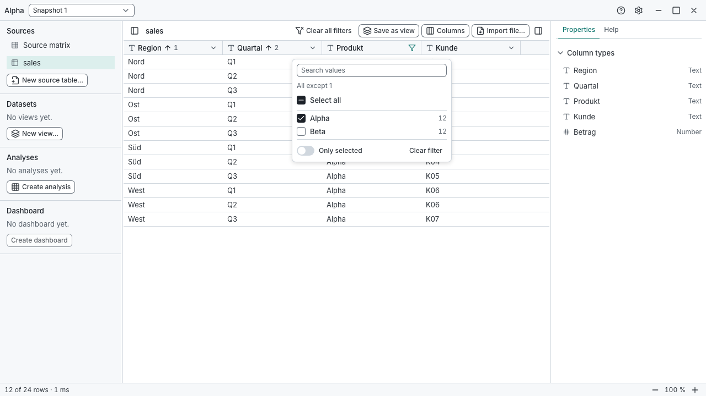
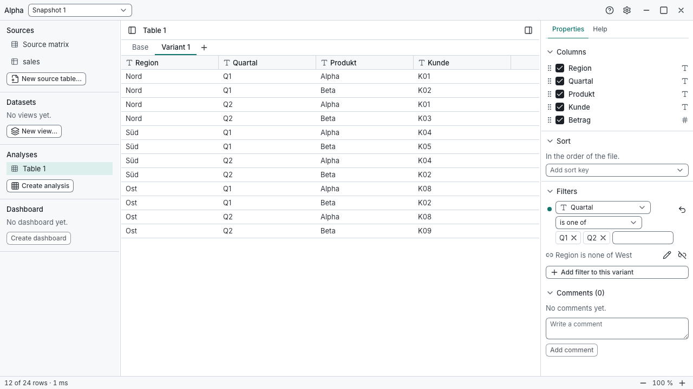
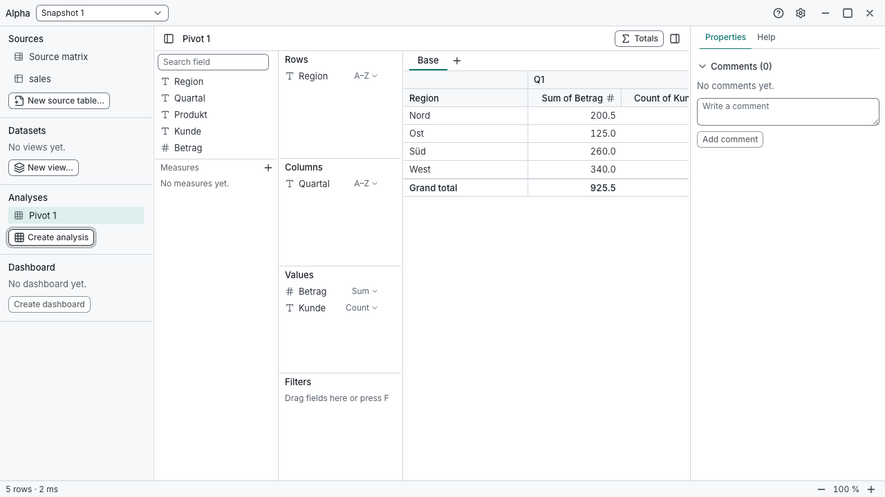

# Table filtering, sorting and grouping: design brief

Source: design decisions of DuckPad (desktop app, Go + DuckDB backend, Vue frontend; repeatable pivot reports on
imported CSV/Excel data). This brief is **stack-neutral**: it states the ideas, the rules and the reasons so you can
rebuild them in another codebase. Names in `code font` are DuckPad's and only illustrate. Adapt to the host app's
conventions; do not copy blindly.

Core goal: **the user works fast on tables with keyboard and mouse, and a saved filter never silently gives wrong
results when the data changes.**

---

> **Screenshots** (folder `table-filter-sort-group-design/`) show DuckPad's **layout and states only**, not a style to
> copy. Use your own project's components and design tokens.
>
> 1. `1-explorer-picker-sort.png`: value picker of a column header with counts, search, mode line "All except 1",
>    "Select all", "Only selected", "Clear filter". Headers show sort order numbers (1, 2), a filled funnel on the
>    filtered column, "Clear all filters" in the toolbar and "12 of 24 rows" in the status bar.
> 2. `2-table-variant-filters.png`: table analysis with variant tabs (Base, Variant 1). Settings panel with Columns,
>    Sort, Filters. One filter overridden in the variant (accent dot, undo arrow), one inherited (link symbol, muted).
> 3. `3-pivot-areas.png`: pivot with field list, the four areas Rows / Columns / Values / Filters, sort selector per
>    field, live result with grand total.





---

## 1. Principles

1. **Excel-like muscle memory.** Header click opens a value picker; Shift-click adds sort keys; Ctrl+Space selects a
   column, Shift+Space a row. Do not invent new gestures where spreadsheets already set one.
2. **Filters are stored as rules, not as snapshots of data.** The default stored form is "all except X", not "only
   A, B, C". New values appear automatically when the data is replaced (new import, next quarter). "Only these" is
   possible, but an explicit, visible choice.
3. **Every change applies at once.** No Apply/OK button on filters, sort or column changes. The grid refetches, the
   status bar updates ("19 of 24 rows").
4. **One state model, pure functions.** Filter, sort and column state are plain data plus pure, immutable functions
   (`toggle`, `selectAll`, `nextSort`, ...), tested without UI. Components only render and emit.
5. **Same widget everywhere.** One condition row (column · operator · value) serves view filters, if-then rules and
   pivot filters. Users learn it once.
6. **Every mouse action has a keyboard path and a command-palette entry**, with a consistent name and shortcut
   everywhere (menu, palette, tooltip, help).
7. **State survives navigation.** Filter, sort, scroll position, selection and split sizes are kept per object when
   the user leaves and returns, and when the project is closed and reopened.
8. **Be defensive when reading saved state** (the file is outside our control): drop invalid entries, duplicates,
   unknown ops; never throw.

---

## 2. Column value filter (the "Excel picker")

### 2.1 Data model

```ts
type FilterValue = string | number | boolean | null   // null = the entry "(empty)"
interface ColumnFilter { column: string; op: 'in' | 'notIn'; values: FilterValue[] }
```

- At most **one filter per column**; filters across columns combine with AND.
- No filter object = all values shown. A `notIn` filter with an empty list is **never stored** (collapses to "no
  filter"). An `in` filter with an empty list is legal: it means "show nothing" (the user unticked everything on
  purpose).
- Equality is strict: `null == null`, number never equals string.
- Mode derived from the filter: `all` (none), `except` (`notIn`), `only` (`in`).

### 2.2 Picker UI (opened by header arrow, header click, or a key)

- Lists the **distinct values of the column with the row count per value**. Counts are computed under the filters of
  the *other* columns (cascading), not under its own filter, so the user sees what remains selectable.
- **Search box** narrows the list (debounced ~200 ms; ignore answers of superseded requests via a generation
  counter; treat "request cancelled" as non-error).
- **"Select all" / clear act on the values currently shown** (i.e. on the search result), enabling "search 'Test' ->
  untick all matches" in two steps.
- Empty cells are one explicit entry "(empty)".
- Values are displayed with the column's format (numbers, dates, booleans as yes/no), but searched by stored text
  (a date is searched as `2026-01-31`); document that.
- List is capped (first 1,000 values) with a "more" flag; the user narrows via search. Never load unbounded lists.
- One line above the list states the mode in words: "All", "All except 2", "Only 3". Users must always see which
  semantics apply.
- Switch **"Only selected"**: converts between modes without changing what is visible right now. Turning on ->
  stores the ticked values as `in`; turning off -> stores the unticked ones as `notIn`.
- **"Clear filter"** removes the column's filter; a global "Clear all filters" appears in the toolbar only while any
  filter is active.
- A filtered column shows a **filled filter icon** in its header.

### 2.3 Behaviour of `toggle` (the key rule)

- No filter yet + click value -> `notIn [value]` (unticking is the first action; ticking is already the default).
- `notIn` list becomes empty after re-ticking -> filter disappears.
- `in` mode: ticking adds, unticking removes.
- Pruning: when a column no longer exists (changed data), its filter and sort key are dropped from state
  (`pruneFilters`, `pruneSort`), and where a saved object references a missing column the UI shows a *warning
  chip* instead of silently ignoring it.

### 2.4 Why "all except" by default

A report is repeated every quarter with new data. A tick-list of the old values would silently drop new customers,
regions or statuses. "All except Test" keeps them. This is the single most important filter decision; carry it over.

### 2.5 Server side

Filtering, counting and sorting run in the database, not in the browser. The grid holds only pages (a few hundred
rows) around the viewport (see section 5).

---

## 3. Condition filters (beyond value picking)

Value picking came first; conditions are the second layer (view filter steps, pivot/table-analysis filters).

**Condition row** = column · operator · value. Rules:

- Operators depend on the column type:
  - Text: is, is not, is one of, is none of, contains, starts with, ends with (+ negations), is empty, is not empty
  - Number: is, is not, one of, none of, <, <=, >, >=, between, is empty, is not empty
  - Date: is, is not, <, <=, >, >=, between, empty, not empty
  - Yes/No: is, is not, one of, none of, empty, not empty
- `between` takes two values, both inclusive. `is one of` takes a **chip list**: type + Enter makes a chip, pasting
  several lines adds all, Backspace in the empty field pulls the last chip back for editing.
- Value field is a **combobox suggesting the column's actual values**.
- Number and date input accept the user's locale (`1'234.50` / `1.234,50`, `31.12.2026`), but the condition is
  **stored locale-independent** (ISO dates, plain numbers) so a project opens identically on every machine.
- The row **only reports valid conditions**; a half-filled one does not apply yet. Invalid value -> error under the
  field, condition inactive until fixed.
- Enter in the value field adds a new row below; remove with a chord (Mod+Alt+Backspace) because plain keys belong to
  the text field.
- Several rows: switch **"All must apply" / "At least one applies"**.
- **Unknown/empty comparisons never match** (empty value in a ">" test does not match); state this in the help.
- If the column is missing in the current data: row keeps it with warning "Column not available"; operator/value
  stay editable, user can pick another column.
- Filter step modes: **"Keep rows that ..."** or **"Remove rows that ..."**, plus optional **"Show removed rows"**
  (preview only: removed rows are grey and struck through). A step shows its effect in the list: "24 -> 9 rows".

### Where does a filter belong? (decision rule)

- **Data cleaning that always applies** (test customers, junk rows) -> filter in the *dataset/view* (applies to all
  analyses on it).
- **The question of the analysis** (this quarter, this region) -> filter in the *analysis* or its *variant*.
- Rule of thumb: *what you never want to see in any analysis belongs in the view.* Say this in the UI help.

---

## 4. Sorting

- **Click header cycles per column:** ascending -> descending -> none.
- **Plain click replaces** the whole sort with this column; **Shift+click adds** the column as a further key (or
  cycles its direction; third Shift+click removes it).
- With more than one key, headers show the **order number** next to the arrow (1, 2, ...).
- Explicit commands exist for the header menu / palette / keys: *Sort ascending*, *Sort descending*, *Remove sort*
  (these set a single key or none).
- Later keys only decide between rows equal on earlier keys.
- With no key, rows keep **source order** (file order). State this; users rely on it.
- A **settings panel** lists the sort keys with number, column, direction toggle, "earlier" (move up) and remove, plus
  "Add sort key", for table analyses where headers are not enough.
- One key per column; reading saved sort drops duplicates and invalid entries.
- **Pivot sorting** is different: sort items of a row/column field by label (asc/desc) or **by a value** ("largest
  first by Sum of Amount"). With several row fields, each field is sorted *within its parent group*.
- In dashboard tiles that embed a table, only sorting is offered (no filter editing).

---

## 5. Speed with large data (hundreds of thousands of rows)

- **Virtual scrolling + paged fetch:** pages of a few hundred rows; only pages around the visible window (a buffer
  on each side) are requested; a hard cap of pages in memory; **one request at a time**; a request for a page that
  is no longer wanted is **cancelled**. A grey placeholder shows briefly during fast scrolling.
- Total row count and unfiltered row count come with every answer -> status bar "n of m rows" and request duration.
- Request carries `{offset, limit, sort[], filters[]}`; backend builds the query. Cancelling uses a request id.
- Number formatting uses decimals of the first rows of the column (known limit; mention it).
- Large results in pivots are **truncated with a visible warning** ("Result cut"); grand totals are still correct
  because they are computed by the database from all rows.

---

## 6. Column handling (part of "working fast")

- Drag column edge to resize; **double-click fits** the content. Drag to reorder. Hide / show. **Freeze up to this
  column.** All remembered per object.
- A **Columns popover/button** shows which columns are visible and lets hidden ones return; a "restore original
  columns" action resets *only* column settings, **never filters or sort** (store them under separate keys:
  `grid:<id>` for width/order/hidden/frozen; `grid:<id>:view` for filter + sort).
- **Header menu** (right-click, or Alt+Arrow-down, or menu key): sort asc/desc/remove, fit, hide, move left/right,
  freeze to here, change type.
- **Keyboard on a focused header:** open filter (key), Shift+Enter = additive sort, move column left/right,
  widen/narrow, hide (Delete; on macOS Backspace, because Mod+0 resets zoom), Ctrl+Space selects column.
- Table analysis: column list with checkboxes (Space toggles), drag grip, and move up/down by keyboard.
  Shown columns first. A column the data no longer has stays in the list, marked, until the user removes it.
- Column type is correctable from the header: a **dot** marks a corrected type, a **warning symbol with count**
  marks values that failed conversion; failed cells are italic with dotted underline.

---

## 7. Selection and copy

- Excel-like: click, arrows, Shift+arrows or drag for ranges; Ctrl/Cmd+Arrow jumps to the edge, Home/End to row
  start/end, PgUp/PgDn a screen; Ctrl+Space column, Shift+Space row, Ctrl/Cmd+A all.
- Copy gives tab-separated text **written as shown on screen** so it pastes into a spreadsheet as a table.
- A range that includes not-yet-loaded rows is **not copied** (clear message) rather than copied incomplete.

---

## 8. Grouping and pivot

### 8.1 Pivot (aggregating grouping)

- Field list of all columns with type icons; four areas: **Rows, Columns, Values, Filters**. Result recalculates live
  after every change.
- Order of fields in Rows/Columns = outer to inner grouping.
- Aggregations: sum, count, average, count distinct. Click a value field to change aggregation.
- **Subtotals and grand totals computed by the database from all rows** (not summed from partial results) so
  distinct count and average are right. "Totals" toolbar toggle switches them on/off.
- **Filters apply before grouping.** Totals and counts include only filtered rows.
- **Keyboard assignment:** with the field list focused, search a field, move with arrows, press one key to send it
  to an area. Keys follow the UI language and are shown in tooltip and help:

  | Area | German | English |
  |---|---|---|
  | Rows | Z | R |
  | Columns | S | C |
  | Values | W | V |
  | Filters | F | F |

  Drag-and-drop does the same; the keyboard path is first-class.
- Filter chips in the Filters area: chip fixes the column, editor shows only operator + value; saved as soon as the
  condition is complete; Esc discards an incomplete one; Delete/Backspace removes the focused chip; Enter edits.
- **Measures:** reusable formulas over aggregates (sum / count), defined per dataset, used only as Values; deleting
  one that is in use asks first and names the users; undo restores both.
- Grouping as a **data step** (a grouped intermediate table with the same editor "group by" / "values") is a planned
  later stage, so users can group *before* analysis. Views have no parameters: keep the column you may need later
  (e.g. quarter) in the view.

### 8.2 Variants (filter sets per report variation)

- Tab bar above the result: **Base**, variants, plus. Typical use: one variant per quarter with its own date filter.
- A new variant starts as a copy of the base and **stores only the difference**. Everything else is *inherited* and
  changes when the base changes.
- Per filter, three visible states, always marked in the UI:
  - **inherited** (link symbol, muted text) -> actions: override, switch off here
  - **overridden / variant-only** (accent dot) -> action: reset to inherit (undo arrow)
  - **switched off in this variant** (struck through, crossed link) -> action: switch on
- Changing a base filter reaches inheriting variants but not overriding ones. A filter added in a variant belongs
  only there.
- Arrow keys, Home, End move between tabs and show the variant immediately.
- Variants exist for all analysis kinds (table, pivot, Gantt...), so the concept is generic.

---

## 9. Table analysis (ungrouped list)

- Rows of a dataset without aggregation: pick columns, order, sort, filters (per variant).
- Meant for small results ("Top 10 customers", open items). **No Top-N limit**; it shows all matching rows.
- Settings panel on the right with sections **Columns**, **Sort**, **Filters**; columns/order/sort always edit
  the base, filters per tab.
- Status bar shows "n of m rows" while filters apply.
- Every change to columns, order, sort or filters is **one undo step**.
- Number/date formats and conditional highlighting belong to the **dataset columns**, not to the table, so every
  analysis shows the same column the same way.

---

## 10. Explorer to view workflow

- "Explore" grid is **read-only**: look, filter, sort, hide.
- **"Save as view"** turns the current filters, column selection and order into steps of a new derived dataset (a
  filter step per filter, column-select step). This closes the loop between exploring fast and making it repeatable.
- A view can be opened in the explorer again ("Open in explorer"), with same filters/sort/columns; "Edit view"
  leads back to the editor. Type correction only at the source.
- Step list shows each step's effect ("24 -> 9 rows", "+1 column"); a step sees only the columns earlier steps
  deliver; renaming a column updates later references; a reference to a missing column gives the step a warning and
  the preview names the step where the column arises.

---

## 11. Warnings instead of silent errors

- A missing column in a filter/sort/grouping never silently disappears: a warning marks the object and all
  dependants (dataset -> analyses -> dashboard tiles), with a click path to the cause.
- Filters never silently drop new values (see 2.4).
- Unmapped new values in a value-mapping column produce a warning in the new snapshot.
- Truncated results announce themselves.

---

## 12. Limits we accepted (first version)

- Picker filters pick values only; conditions (">", "contains") live in view/analysis filters, not in the header.
- Copy of a huge table (many thousand rows) is not supported in one go.
- Relative date ranges ("last completed quarter") and prior-period comparison are deferred; date filters are fixed
  ranges (01.07.-30.09.).

---

## 13. Checklist for porting

1. Implement filter/sort as pure data + functions with unit tests (toggle, select-all-on-shown, only-selected
   conversion, sort cycle, prune, defensive parse).
2. Default to `notIn`; show the mode sentence in the picker.
3. Picker with counts (cascading), debounced search, cap + "more", "(empty)" entry.
4. Server-side filter/sort/count + paged virtual grid with cancellation.
5. Persist filter+sort separately from column layout, per object.
6. Header menu + keyboard shortcuts + command palette for every header action; same names everywhere.
7. Shared condition row for all filters; locale-independent storage.
8. Variants with inheritance only if reports repeat with changing scope.
9. Pivot totals computed by the DB; filters before grouping; keyboard area assignment.
10. Status bar "n of m rows"; undo for every settings change.
